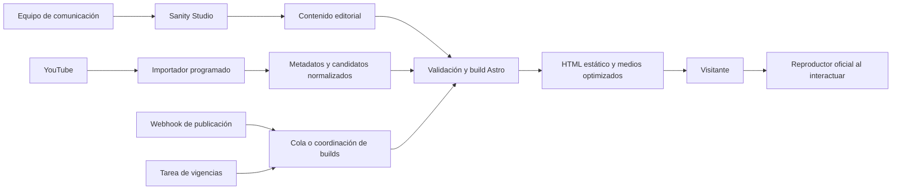

# Caudal de Vida · Guía de desarrollo y continuidad

Actualizado: **17 de octubre de 2026**, zona `America/Argentina/Buenos_Aires`.

Este documento es el punto de entrada para continuar el proyecto con otros agentes o desarrolladores. Registra el estado real, decisiones del cliente, fuentes, estructura de archivos y propuesta de implementación del sitio público, backend editorial y administración. **La arquitectura de producción aquí descrita es un plan; todavía no está implementada ni contratada.**

## 1. Objetivo y estado actual

Crear una web para la iglesia **Caudal de Vida**, en San Miguel, Buenos Aires: moderna, rápida, cálida y fácil de actualizar. Debe recibir a nuevos visitantes, mostrar mensajes y actividades, conectar con grupos y acompañar el siguiente paso. El público recibirá HTML estático; el equipo de comunicación actualizará contenido desde un panel.

La iglesia está relacionada con **Instituto Cultura**, desarrollado anteriormente según el cliente. Su repositorio, URL y decisiones técnicas no están disponibles en este workspace. No atribuirle una implementación ni confundirlo con **Cultura Jóvenes**, que es otra sección.

| Área | Estado comprobado |
| --- | --- |
| Documento original | Leído y procesado en el plan de desarrollo |
| Plan, textos y preguntas | Documentados; los textos siguen siendo propuestas por validar |
| Lectura de identidad | Muestra de Instagram, web actual y miniaturas de YouTube documentadas |
| Propuestas de home | Seis prototipos HTML completos, navegables, cada uno en claro y oscuro |
| Preferencia estética | El cliente prefiere la propuesta 02; no equivale a aprobación final para publicar |
| Referentes | Doce fichas; once sitios capturados y una referencia sin identificar |
| Entregables de presentación | Galería HTML, dossier HTML, PDF de referentes y ZIP conjunto |
| Automatizaciones | Viabilidad y reglas documentadas; ninguna cuenta conectada |
| Backend y admin | Propuestos; sin instalar ni configurar |
| Producción | Sin migración, CMS, formularios de captura ni despliegue de este proyecto |

La carpeta actual no contiene `.git`, `package.json`, lockfile ni aplicación Astro. `newsite/` existe y está vacía. Los HTML actuales se generan con Python y funcionan sin dependencias de Node. No son todavía una aplicación de producción con contenido administrable.

## 2. Decisiones e instrucciones del cliente

1. Sitio público estático y moderno, con actualización simple y base modular para crecer.
2. Reutilizar principalmente Instagram y YouTube de la iglesia; son los dos canales confirmados.
3. La propuesta **02 · El encuentro** es la preferida y guía la siguiente iteración.
4. La propuesta **01 · Casa abierta** debía perder el recorte semicircular de la fotografía. Ya usa imágenes rectangulares con esquinas discretas.
5. Se pidió una alternativa más arriesgada, inspirada en experiencias de Apple con elementos ligados al scroll. Se reformuló la **06 · Un lugar para vos**.
6. Todas las propuestas deben ofrecer modo claro y oscuro. Las seis ya lo tienen.
7. Se exploró música desde una playlist de YouTube Music. El prototipo actual **abre la playlist oficial**; no implementa un reproductor de audio independiente.
8. Se propuso mensajes en video y audio tipo podcast. **El cliente dejó la decisión del podcast para más adelante.** No incluirlo como requisito cerrado de lanzamiento.
9. El cliente confirmó `https://iebcordoba.es/` como referencia bautista. Corresponde a **Córdoba, España** y está clasificada entre las internacionales.
10. No se aprobaron aún hosting, presupuesto de servicios, cuentas de CMS, fuentes tipográficas finales ni lanzamiento.

Si documentos anteriores discrepan, las instrucciones más recientes del cliente tienen prioridad. El SVG de exploración estética y algunos pasajes históricos del plan representan etapas anteriores: para juzgar la estética actual usar **la galería y los prototipos generados**, especialmente 02 y 06.

## 3. Documentación y archivos existentes

Todos los enlaces de esta guía son relativos a la raíz del proyecto. Ruta de trabajo de esta sesión: `/Users/diego/_AANexus/localhost/caudaldevida`; no codificarla en la futura aplicación.

| Archivo o carpeta | Para qué sirve |
| --- | --- |
| [docs/web-caudal.md](docs/web-caudal.md) | Documento original del cliente. Conservar como fuente, sin reinterpretarlo como aprobación de cada propuesta |
| [docs/plan-de-desarrollo.md](docs/plan-de-desarrollo.md) | Diagnóstico, arquitectura de información, textos demo, sistema visual, modelos, fases y alcance |
| [docs/preguntas-para-el-cliente.md](docs/preguntas-para-el-cliente.md) | Cuestionario amplio para cerrar información y decisiones pendientes |
| [docs/automatizacion-de-contenidos.md](docs/automatizacion-de-contenidos.md) | Integraciones, playlists, fuentes de verdad, vencimientos y fallas |
| [docs/propuestas-esteticas.svg](docs/propuestas-esteticas.svg) | Lámina inicial; no reemplaza las seis propuestas HTML ni su revisión estética |
| [docs/muestra-instagram/lectura.md](docs/muestra-instagram/lectura.md) | Contexto de la muestra visual; la misma carpeta conserva la captura de Instagram |
| [prototipos/index.html](prototipos/index.html) | Galería actual: seis conceptos, doce variantes y enlaces al dossier |
| [prototipos/README.md](prototipos/README.md) | Uso, alcance y verificación de los prototipos |
| [referentes/index.html](referentes/index.html) | Dossier interactivo de referentes para mostrar al cliente |
| [referentes/README.md](referentes/README.md) | Uso y regeneración del dossier |
| [referentes/Dossier referentes Caudal de Vida.pdf](<referentes/Dossier referentes Caudal de Vida.pdf>) | Exportación del dossier de referentes; no es un PDF de las seis propuestas |
| `Presentacion Caudal de Vida.zip` | Paquete local de entrega. No se versiona: repite prototipos y referentes |
| `newsite/` | Carpeta vacía reservable para la implementación de producción |
| `developr.md` | Esta guía de continuidad; mantenerla actualizada |

### Fuentes de los prototipos

```text
prototipos/
  generar.py             # Catálogo de conceptos, heroes, orden de secciones y galería
  templates/             # Contenido HTML compartido, accesos rápidos, secciones y pie
  styles.css             # Base visual y composiciones originales
  refinements.css        # Revisión estética actual, paletas y relato de scroll
  theme-init.js          # Resuelve apariencia antes del CSS
  app.js                 # Menú, video, apariencia y scroll
  01-...html a 06-...html # Resultados generados
  index.html             # Galería generada
  assets/                # Fotos, logo y miniaturas locales
  assets/fuentes.json    # Procedencia y fecha de los archivos
  previews/              # Capturas para la galería, incluidas -light.jpg y -dark.jpg
  verificacion.json      # Resultado de la última revisión de las doce variantes
```

Para cambios persistentes editar `generar.py`, `templates/`, CSS o JS según corresponda. **No editar únicamente un HTML generado:** se perderá al regenerar. Los estilos de `refinements.css` se cargan después de `styles.css`; revisar ambos antes de diagnosticar una regla. Al migrar a producción, consolidar los tokens y estilos elegidos en componentes, evitando trasladar indefinidamente reglas sobrescritas de seis conceptos.

Los nombres de archivo de las seis propuestas se conservan para no romper enlaces del dossier:

| Archivo | Dirección actual |
| --- | --- |
| `01-casa-abierta.html` | Editorial cálida, bordó y crema, fotos rectangulares |
| `02-el-encuentro.html` | Principal: escena de reunión, azul y arena, jerarquía cinematográfica |
| `03-vida-para-la-ciudad.html` | Retícula editorial urbana y misión |
| `04-tu-siguiente-paso.html` | Orientación, señalética y recorrido por acciones |
| `05-esta-semana.html` | Actualidad, mensajes y agenda modular |
| `06-un-lugar-para-vos.html` | Tipografía de gran escala, profundidad y relato de scroll en tres capítulos |

### Comportamientos implementados

- Navegación por anclas, selector de propuesta, menú móvil y preguntas frecuentes.
- Apertura de video oficial en un `dialog`, carga del iframe al interactuar, enlace a YouTube y retiro del iframe al cerrar.
- Apariencia: `?theme=light` o `?theme=dark` tiene prioridad; luego `localStorage['caudal-theme']`; después el valor inicial del documento. La 02 abre en oscuro si no hay preferencia; las otras, en claro. `theme-init.js` evita el destello inicial.
- Cambio de apariencia desde la barra superior, persistencia en este navegador y miniaturas de galería acordes con el modo.
- La 06 liga posición, escala y visibilidad al scroll nativo mediante `requestAnimationFrame`; no captura la rueda ni los gestos. En pantallas de hasta 760 px y con `prefers-reduced-motion`, muestra los capítulos consecutivos sin fijación. Sin JavaScript el contenido permanece visible. Los capítulos ocultos quedan fuera del foco mediante `inert`.
- WhatsApp, Maps y enlaces a canales oficiales. No se envían solicitudes automáticamente.

### Evidencia del dossier

`referentes/generar.py` mantiene las fichas editoriales y genera HTML y `seleccion.js`. `capturar.cjs` usa Chrome DevTools Protocol con un perfil temporal para obtener capturas públicas. `medir-alcance.py` realizó lecturas puntuales de canales; no es la integración YouTube de producción.

`referentes/datos/` conserva observaciones, lecturas, identificación y QA. `capturas/` contiene escritorio, móvil y recorridos ampliados. La interfaz permite buscar, filtrar, ampliar, seleccionar hasta tres casos, comparar e imprimir.

Estado: **siete internacionales y cinco referencias argentinas**. Iglesia Adoración de Buenos Aires sigue sin identificación fiable; `adoracion.co` se descartó porque declara Barranquilla, Colombia. Centro de Adoración corresponde al sitio localizado de Ministerio Altares, Villa Sarmiento: sigue pendiente confirmar que era la referencia genérica originalmente pretendida. El Rey Jesús identifica Palermo, pero no se confirmó la denominación «bautista» aportada al inicio. Missio tiene el dominio corregido `https://www.iglesiacristianamissio.com/`.

No se acreditó que todas las iglesias tengan más de 5.000 asistentes. Las cifras de YouTube son lecturas fechadas de canales concretos: no prueban tráfico web, audiencia única, engagement ni tamaño de congregación. Elevation conserva una limitación observada de carga del recurso visual principal; no presentar esa captura como prueba de una falla permanente.

## 4. Cómo abrir y regenerar lo existente

Desde la raíz:

```sh
python3 -m http.server 8766 --bind 127.0.0.1
```

Abrir `http://127.0.0.1:8766/prototipos/` o `http://127.0.0.1:8766/referentes/`. Detener con `Ctrl+C`. También se pueden abrir los HTML directamente; para probar videos es preferible HTTP local. El entorno de un agente puede exigir permiso para iniciar el servidor o acceder a la red.

Regeneración sin conexiones externas:

```sh
python3 prototipos/generar.py
python3 referentes/generar.py
```

Estos comandos **no actualizan** capturas, miniaturas ni PDF. Tras cambiar el diseño, volver a capturar las doce variantes y actualizar `previews/`; después exportar el PDF si cambió el dossier y reconstruir el ZIP si debe entregarse actualizado.

Para capturas de referentes: iniciar un Chrome temporal con perfil aislado y DevTools en puerto 9342; luego ejecutar, por ejemplo:

```sh
CAPTURE_IDS=ieb-cordoba node --experimental-websocket referentes/capturar.cjs
```

`CDP_PORT` permite cambiar ese puerto. La implementación actual cierra el navegador que usa al terminar: **no conectarla a una sesión personal del usuario**. `capturas.json` puede quedar limitado a la selección de una ejecución; para un resumen completo reconstruirlo desde los doce JSON de fichas. Revisar el resultado antes de reemplazar evidencia válida.

La sesión usó scripts de QA y exportación en `/private/tmp`; **no forman parte del proyecto ni se garantiza que sigan existiendo**. Los informes JSON y las imágenes de entrega sí están guardados en el workspace. Al preparar producción, incorporar scripts de QA reproducibles al repositorio.

## 5. Fuentes y contenido para continuar

Canales confirmados por el cliente:

- Sitio existente: [caudaldevida.net](https://caudaldevida.net/).
- Instagram: [@caudaldevida](https://www.instagram.com/caudaldevida/).
- YouTube: [@CaudaldeVida](https://www.youtube.com/@CaudaldeVida).

Playlists identificadas durante la investigación, pendientes de selección editorial final y comprobación de reproducción:

| Colección | ID |
| --- | --- |
| MENSAJES | `PLIbltRa2HNAY7KF8jUyNH19HXvHs7rXpr` |
| Día a Día · Temporada 2 | `PLIbltRa2HNAZoZDhbLUqf5fku2pKwtHBX` |
| Día a Día · Temporada 1 | `PLIbltRa2HNAYiZKJ5V4Kwq06ZF3RlHrV5` |
| MÚSICA | `PLIbltRa2HNAaF7hf6d8KQyFWekqSGzXFR` |

Los prototipos incluyen «Cuando llega Jesús» (`2vUdQ47sa5c`) y «Espera, ¡No te rindas!» (`_o1LLJkFLE8`). Son ejemplos existentes; no se afirma que sean el último mensaje vigente.

Datos de muestra tomados de las fuentes: España 1626, San Miguel; WhatsApp `+54 11 3823 0456`. Revalidarlos con la iglesia antes de publicar. Los horarios de las fuentes no coinciden plenamente: se eligió indicar consulta de horarios, sin inventar una versión definitiva. Los eventos son ilustrativos, sin fechas activas confirmadas. No fabricar testimonios, números de asistentes ni resultados de campañas.

Las fotos y miniaturas locales tienen procedencia en `prototipos/assets/fuentes.json`. Las URLs originales de CDN pueden vencer. Para producción obtener originales, autorizaciones y recortes adecuados; no depender de volver a descargar medios desde una URL temporal. El logo y los colores usados son recursos de exploración, no un manual de marca validado. No se generaron imágenes con IA para sustituir la vida real de la comunidad.

## 6. Arquitectura de producción propuesta

**Recomendación: Astro estático + TypeScript + Sanity Studio, con un proceso de publicación y pequeñas funciones de integración.** No construir un CMS propio en la primera versión. El plan previo también evaluó Decap CMS como alternativa si presupuesto o dependencia de proveedores cambian; no está seleccionado ni instalado.

| Capa | Tecnología propuesta | Responsabilidad |
| --- | --- | --- |
| Web pública | Astro, salida estática y TypeScript | Generar páginas, metadatos, componentes y bibliotecas desde datos validados |
| Interacción pública | CSS y JavaScript acotado | Menú, apariencia, filtros y reproductores; mantener contenido legible sin JS |
| Administración | Sanity Studio con esquemas y estructura editorial propia | Formularios, imágenes, relaciones, borradores y publicación |
| Backend de contenido | Sanity Content Lake y medios de Sanity | Persistencia editorial; separar entornos y accesos |
| Integraciones | Módulos TypeScript ejecutados en tareas programadas | YouTube, candidatos sociales, agenda futura, normalización y exclusiones |
| Funciones pequeñas | Runtime serverless del hosting elegido | Recepción de webhooks, lanzamiento de procesos y formularios si se incluyen |
| CI y publicación | Repositorio Git y pipeline del proveedor | Validar, construir, publicar de forma atómica y permitir rollback |
| Hosting | Proveedor por confirmar; evaluar alojamiento estático con funciones y scheduler | Servir archivos, configurar dominio, TLS, previews y caché |

Como opción de infraestructura se puede evaluar Cloudflare para estáticos y funciones/tareas; no se asumirá una cuenta, producto o plan contratado. Si el hosting existente ya cubre publicación atómica, funciones y programación, priorizar reutilizarlo. El proveedor final debe resolverse antes de implementar su adaptador, scheduler y despliegue.

Astro genera el sitio con `astro build`; el resultado estático puede servirse sin un servidor Node permanente. Un backend para formularios o previews se implementa por separado. Ver [despliegue de Astro](https://docs.astro.build/en/guides/deploy/). Las versiones exactas se elegirán al iniciar la implementación, verificando compatibilidad y fijando dependencias y lockfile; no interpretar la versión local usada para capturas como requisito de producción.



El frontend público no consultará el CMS ni las APIs para dibujar cada visita. El backend existe para editar, integrar, publicar y atender las funciones que necesiten ejecución en servidor.

## 7. Organización propuesta para la implementación

Mantener `prototipos/` y `referentes/` como material de revisión. Crear la aplicación de producción en `newsite/` cuando comience esa fase, sin sobreescribir los prototipos.

Estructura orientativa, **aún inexistente**:

```text
newsite/
  package.json                    # Workspaces y comandos documentados al crearlos
  apps/
    web/
      src/components/             # Header, Hero, EventCard, MessageCard, etc.
      src/layouts/
      src/pages/
      src/styles/                 # Tokens semánticos y ambas apariencias
      src/lib/content/            # Consultas al CMS y transformación a modelos públicos
      public/
    studio/
      schemaTypes/                # Modelos de Sanity
      structure/                  # Menú de edición en español
      components/                 # Ayudas y controles editoriales necesarios
    services/
      src/webhooks/               # Validación y coordinación de publicación
      src/jobs/                   # Importadores y tareas de vigencia
      src/forms/                  # Solo si se aprueban formularios propios
  packages/
    content/                      # Tipos, validadores y contratos compartidos
  tests/                          # Reglas de dominio, integración y navegación
  .env.example                    # Nombres de configuración, sin secretos reales
  README.md                       # Arranque y operación reales
```

Usar una versión LTS de Node compatible con las dependencias elegidas y fijarla en configuración del proyecto. Elegir un solo gestor de paquetes y versionar su lockfile. Configurar scripts de desarrollo, build, chequeo de tipos, tests y Studio al implementar; **hoy no existen comandos npm/pnpm funcionales para este proyecto**.

## 8. Admin: experiencia de actualización

Sanity Studio será el panel editorial, con campos y ayudas en español. El equipo no debería editar HTML, CSS, slugs a mano en casos habituales ni decidir márgenes y colores por publicación. Las opciones de composición serán componentes permitidos, no un constructor libre.

Menú propuesto:

| Sección del admin | Qué actualiza el equipo |
| --- | --- |
| Inicio | Bienvenida, destacado, acciones y selección de bloques autorizados |
| Agenda | Eventos, imágenes, promoción, inscripción y estado |
| Mensajes y series | Candidatos importados, título editorial, orador, serie, destacado y exclusiones |
| La vida en Caudal | Reels seleccionados, enlace, título, imagen autorizada y vigencia |
| Grupos y siguientes pasos | Público, zona pública, disponibilidad, contactos y recorridos |
| Ministerios y Misiones | Presentaciones, campañas, historias y acciones |
| Datos de la iglesia | Dirección, horarios centralizados, canales y medios de contacto |
| Páginas | Nosotros, creencias y textos institucionales aprobados |
| Estado de publicación | Último build, sincronización, errores y última versión publicada |

La estructura de navegación se personaliza con [Structure tool de Sanity](https://www.sanity.io/docs/studio/structure-tool). El panel de estado y la coordinación de publicación son trabajo propio, no funciones que se consideren terminadas por instalar Studio.

### Flujos cotidianos

**Actualizar un evento:** crear borrador → completar título, fecha/zona, imagen y acción → revisar vista previa → publicar → ver confirmación de despliegue. Cancelar debe retirar su promoción y mantener el aviso o destino que se acuerde para enlaces existentes.

**Actualizar el inicio:** seleccionar un evento o bienvenida permanente → indicar ventana de promoción → revisar imagen móvil/escritorio y botón → publicar. Evitar volver a escribir la fecha si ya viene del evento.

**Publicar un mensaje:** importar desde playlists aprobadas → revisar o completar contexto → incluir, excluir o fijar → publicar. No volver a cargar el video en el CMS.

**Elegir un reel:** pegar URL oficial → agregar título, portada autorizada y vigencia si corresponde → probar inserción → seleccionar para portada → publicar.

**Corregir horarios:** modificar la configuración central → construir todas sus apariciones. Las publicaciones sociales no deben sobrescribir estos datos automáticamente.

### Accesos y revisión

Usar cuentas nominadas con autenticación del proveedor; no implementar un formulario propio de contraseñas. Perfiles deseados: administración técnica, responsable editorial y colaborador. Los permisos efectivos y el flujo de aprobación dependen del plan de Sanity: verificarlos antes de prometer restricciones por tipo de documento o aprobación obligatoria. Ocultar un botón en Studio no sustituye autorización real.

MVP: distinguir borrador/publicado y designar responsables. Si se requiere separación técnica estricta entre quien redacta y quien publica, implementarla con capacidades verificadas del plan o adaptar el alcance; no simularla con etiquetas.

### Vista previa

Producción se construye solo con contenido publicado. Preparar un entorno de preview protegido que pueda leer borradores mediante credencial de servidor; nunca incluir ese token en el navegador o el HTML. La edición visual de Sanity puede usarse, pero necesita integrar la vista previa y su acceso. Ver [edición visual de Sanity](https://www.sanity.io/docs/visual-editing/introduction-to-visual-editing).

Aislar caché y despliegues de preview de producción. `noindex` es una indicación de indexación, no protección de acceso. Confirmar el proveedor antes de decidir entre preview renderizado en servidor o builds privados de borrador.

## 9. Modelos y contratos de contenido

| Modelo | Campos mínimos propuestos |
| --- | --- |
| `siteSettings` | Nombre, logo, dirección, coordenadas, reuniones con día/hora, zona horaria, contactos, redes, datos verificados para Dar |
| `homePage` | Bienvenida, imagen por recorte, acciones, destacado referenciado y orden de bloques permitidos |
| `event` | Título, slug, resumen, inicio/fin, zona, estado, lugar, imagen/alt/recorte, inscripción, promoción, elegibilidad de portada |
| `message` | Identidad externa, fechas de origen, fecha de predicación opcional, título editorial, orador, series/temas, resumen, exclusión y destacado |
| `series` | Nombre, slug, descripción, portada y asociación de mensajes |
| `socialPost` | URL/ID externo, fuente, título, portada autorizada, categoría, selección y vigencia |
| `group` | Nombre, público, zona pública, día/hora, modalidad, disponibilidad y contacto autorizado |
| `nextStep` / `ministry` | Nombre, público, descripción, acciones, contacto y eventos relacionados |
| `missionStory` / `campaign` | Historia o campaña, fechas, fotos autorizadas, necesidades y formas de participar |
| `institutionalPage` | Título, slug, bloques permitidos, SEO y acciones |
| `integrationRun` / `deploymentStatus` | Fuente, resultado, fechas, errores resumidos y referencia a ejecución; acceso administrativo |

Los nombres son orientativos. Implementar validaciones de longitud, URLs y protocolos permitidos, campos requeridos, slugs únicos, fechas coherentes y texto alternativo. No aceptar scripts, iframes arbitrarios ni HTML de terceros sin tratamiento controlado.

Todo contenido importado tendrá identidad estable, por ejemplo `source + externalId`, junto con `sourceUpdatedAt`, `lastFetchedAt` y un estado de disponibilidad. Separar `sourceTitle` de `editorialTitle`, así como datos importados de exclusiones, prioridad y selección. Una sincronización no debe borrar el trabajo del editor.

Usar referencias para los datos compartidos: el evento alimenta sus tarjetas y el destacado, los horarios provienen de configuración, los mensajes se relacionan con series. Para objetos integrados conservar también la identificación de la cuenta o calendario de origen. No asumir unicidad global de un ID de evento fuera de su calendario.

## 10. Publicación, vigencias y recuperación

Flujo propuesto:

1. Studio guarda borradores; publicar contenido genera un webhook filtrado a cambios públicos relevantes.
2. El receptor valida autenticidad con el mecanismo documentado por el proveedor, registra una clave idempotente y agrupa cambios cercanos.
3. Un coordinador evita builds simultáneos y ciclos causados por las propias importaciones o por actualizaciones del estado administrativo.
4. El build consulta una versión coherente de contenido publicado, valida modelos, calcula destacados y produce páginas y metadatos.
5. Las comprobaciones mínimas bloquean la promoción si hay datos críticos inválidos o errores de construcción.
6. El hosting publica una versión completa de forma atómica. Si falla, sigue disponible la versión anterior.
7. El panel distingue **guardado**, **publicado en CMS** y **visible en web**; muestra la última publicación correcta y el error relevante.

Sanity ofrece webhooks configurables; el receptor y el despliegue son integración propia. Ver [webhooks de Sanity](https://www.sanity.io/docs/content-lake/webhooks).

### Regla del destacado

1. Destacado manual publicado y vigente, siempre que el evento asociado no esté cancelado ni vencido.
2. Próximo evento publicado elegible para portada, ordenado por fecha y prioridad de desempate.
3. Bienvenida permanente con información institucional central.

Separar fecha del evento de inicio/fin de promoción. Para recurrencias, representar ocurrencias o una política explícita. Guardar instantes absolutos y conservar zona IANA; tratar un evento de día completo como fecha local, sin convertirlo automáticamente en medianoche UTC.

La web estática cambia al volver a publicarse. Proponer una tarea cada quince minutos que evalúe vigencias y reconstruya **cuando cambia el resultado público**, además del webhook. Este intervalo es una decisión inicial de operación sujeta a límites del hosting; no garantiza publicación instantánea. La latencia incluye espera, construcción y despliegue.

Una comprobación ligera del navegador puede ocultar un destacado vencido y mostrar la bienvenida si se demora el build. Es una defensa complementaria: el scheduler debe actualizar también el HTML y sus metadatos. No servir indefinidamente una convocatoria finalizada a usuarios sin JavaScript.

### Fallas y backups

- Una consulta fallida no significa catálogo vacío: distinguir error de respuesta válida sin elementos.
- Retener temporalmente el último resultado válido, con límite de antigüedad por fuente y aviso al responsable.
- Evaluar vencimientos con datos ya conocidos aunque falle una integración.
- Revalidar disponibilidad y eliminar datos externos cuando corresponda por políticas o retiros; no conservarlos indefinidamente por una caída.
- Registrar última sincronización correcta, cantidad de cambios y errores sin tokens ni datos personales.
- Versionar el código; programar exportaciones de contenido y medios según capacidades del proveedor, con copia separada y prueba de restauración.
- Un rollback de archivos no debe reactivar eventos ya vencidos: recalcular temporalidad o mantener la alternativa permanente.

## 11. Integraciones: implementación por etapas

### YouTube: primera integración

El MVP puede comenzar con el reproductor oficial de una playlist. Para una biblioteca de fichas estáticas, implementar consulta de `playlistItems.list`, paginación y enriquecimiento con `videos.list`; la reproducción y la indexación propia son necesidades distintas. Ver [playlistItems.list](https://developers.google.com/youtube/data/reference/rest/v3/playlistItems/list) y [videos.list](https://developers.google.com/youtube/data/reference/rest/v3/videos/list).

Propuesta: consultar cada 30–60 minutos, normalizar por `videoId`, conservar pertenencia a varias series y construir si cambió el resultado visible. Confirmar la curaduría de MENSAJES. No usar búsquedas generales repetidas ni deducir Shorts solo por duración. Distinguir fecha de publicación, incorporación a playlist y predicación.

Excluir de portada pruebas, emisiones futuras y contenido no elegible. Las reproducciones se cargan al interactuar y siempre ofrecen enlace oficial. Para En vivo usar un ID y estado confirmados; el horario de culto por sí solo no prueba una transmisión activa. Preservar atribución y controles del reproductor. Revalidar cuotas, políticas de datos y compatibilidad antes de conectar.

### Instagram: selección antes que importación total

Primera versión: tres publicaciones/reels elegidos desde el panel, con inserción oficial cuando esté permitida y enlace alternativo. Escribir título web y vigencia; una convocatoria vencida no se debe promocionar por ser una publicación reciente.

Leer todas las publicaciones de una cuenta y embeber una URL conocida son integraciones diferentes. La importación requiere verificar modalidad de API, tipo de cuenta, permisos y autorización del administrador. No se confirmó acceso profesional ni se conectaron credenciales. Revisar la documentación vigente de Meta al implementarlo; no dar por actuales los requisitos de acceso u oEmbed registrados en el estudio previo.

No usar scraping de Instagram ni URLs temporales como infraestructura del feed. Si se aloja un clip propio, partir del original autorizado y verificar su música. Cargar scripts e incrustaciones a demanda, con alternativa cuando el contenido no pueda mostrarse.

### Música y podcast

La playlist MÚSICA se abre actualmente en YouTube Music. Si se incorpora un embed será el reproductor oficial compatible, con video y controles visibles. **No extraer audio de YouTube, ocultar el video ni simular un servicio de audio independiente.**

El podcast queda pendiente. Solo añadir reproducción de audio o RSS cuando exista una fuente de audio autorizada, almacenamiento/feed definido y criterio editorial. Un video disponible en alguna experiencia de YouTube Music no garantiza un endpoint de audio reutilizable por esta web. Las reglas de inserción deben verificarse con las [políticas de YouTube](https://developers.google.com/youtube/terms/developer-policies).

### Google Calendar: fase posterior

Uso no confirmado. Si se incorpora, utilizar una agenda dedicada a publicación. Calendar será la fuente de fechas, lugar y cancelaciones; el CMS agregará imagen, prioridad y CTA mediante una referencia externa. Conservar el acceso de solo lectura y no publicar enlaces privados de suscripción.

Resolver recurrencias, excepciones, cancelaciones, eventos de día completo y zona horaria. Comenzar con una ventana acotada y paginada; la sincronización incremental y push son mejoras posteriores, con mantenimiento explícito. Referencia: [events.list](https://developers.google.com/workspace/calendar/api/v3/reference/events/list).

Sheets, Drive, Forms, Canva y plataformas de inscripciones quedan como posibilidades, no herramientas confirmadas. Preferir una fuente de verdad y evitar doble edición.

## 12. Formularios, credenciales y datos privados

Para el lanzamiento se pueden conservar enlaces de WhatsApp y plataformas de inscripción existentes. Si se requieren formularios propios, implementar endpoints con validación de servidor, control de abuso y destinatario acordado. El HTML estático no guarda solicitudes ni envía correo por sí solo.

Las solicitudes pastorales no deben almacenarse en el contenido público, el repositorio, parámetros de URLs ni analítica. Definir responsables, acceso y eliminación antes de elegir persistencia. El backend editorial no es una base pastoral ni un sistema de membresía.

Separar credenciales de lectura para builds, escritura para importadores y acceso administrativo. Los secretos se guardan en el entorno seguro del proveedor, no en archivos publicados o en esta guía. Dataset público o privado, permisos, CORS y planes deben configurarse de acuerdo con el uso real. Recomendación inicial: solo contenido destinado a publicación en el CMS editorial; si el dataset requiere lectura autenticada, resolverla desde build/servidor.

Nombres orientativos para el futuro `.env.example`, sin valores:

```text
SITE_URL
SANITY_PROJECT_ID
SANITY_DATASET
SANITY_API_VERSION
SANITY_READ_TOKEN
SANITY_SYNC_TOKEN
SANITY_WEBHOOK_SECRET
YOUTUBE_API_KEY
PUBLICATION_TRIGGER_SECRET
PREVIEW_SECRET
# Calendar, Meta y correo: agregar solo al activar esas integraciones.
```

IDs de proyecto no equivalen a tokens, pero ningún secreto debe recibir prefijos que lo expongan al cliente. Configurar rotación y responsable de las cuentas. No crear cuentas, compras o despliegues como efecto colateral de actualizar prototipos o documentación.

## 13. Verificación existente y criterios de aceptación

### Lo comprobado hasta ahora

`prototipos/verificacion.json` registra las doce variantes a 1440 × 1000, 390 × 844 y 320 × 780: sin desbordes horizontales, imágenes faltantes ni excepciones JS. Se verificaron menú, FAQ, diálogo y retiro del iframe, selector/persistencia de apariencia, miniaturas, cambios efectivos de transformación durante el scroll, capítulos legibles sin superposición en puntos de control y alternativa con movimiento reducido.

`referentes/datos/verificacion.json` registra doce fichas, once disponibles, una pendiente, filtros 7/5, búsqueda, comparación de tres casos y ampliación de capturas. También se verificó la existencia de enlaces y recursos locales. Las capturas se revisaron visualmente.

Esto no certifica reproducción de YouTube de extremo a extremo, accesibilidad completa, navegadores múltiples, rendimiento de producción, seguridad de un admin ni publicación remota. Aún no existen esas partes.

### Pruebas que debe incorporar producción

- Reglas: destacado vigente, cancelación, promoción independiente, zonas horarias y recurrencias.
- Importadores: paginación, idempotencia, exclusiones, fechas distintas y respuesta fallida frente a catálogo vacío.
- Publicación: webhook auténtico, repetido o inválido; ausencia de bucles; build fallido conservando sitio anterior.
- Acceso: borradores y tokens fuera de producción; permisos efectivos del panel; preview protegido.
- UI: primera visita, agenda, filtros, mensajes, teclado, ambas apariencias, móvil y movimiento reducido.
- Medios: tamaños y recortes, alternativas, `alt`, scripts bajo demanda y reproductor no disponible.
- Operación: vencimiento sin edición manual, aviso de errores, rollback y restauración de contenido.

Usar pruebas unitarias para reglas de negocio y Playwright o equivalente para recorridos relevantes. Comprobar semántica, foco, contraste y reducción de movimiento; una captura correcta no demuestra accesibilidad. No cargar una SPA completa solo para reproducir las interacciones actuales.

## 14. Orden de trabajo para el siguiente agente

| Etapa | Trabajo | Resultado verificable |
| --- | --- | --- |
| 1. Retomar contexto | Leer esta guía, fuente original, plan y README; abrir 02 y 06 en ambos modos | Comprender la preferencia vigente y lo que ya está hecho |
| 2. Cerrar datos críticos | Confirmar horarios, contactos, marca, responsables, playlists y vínculo con Instituto Cultura | Contenido institucional y alcance utilizables |
| 3. Cerrar infraestructura | Hosting, Git, CMS, presupuesto, acceso, preview y operación | Decisión técnica documentada, sin contratos implícitos |
| 4. Crear base | Astro estático, TypeScript, tokens, componentes y entorno de desarrollo en `newsite/` | Home 02 reproducida con datos locales y ambas apariencias |
| 5. Modelar admin | Sanity Studio, configuración, home, eventos, mensajes y series | Editor actualiza una imagen, horario y evento sin tocar código |
| 6. Conectar publicación | Lectura de publicados, preview protegido, webhook y despliegue de revisión | Borrador aislado; publicación visible y errores comprensibles |
| 7. Integrar contenido | YouTube y reels seleccionados con fallbacks | Biblioteca actualizable, sin borrar curaduría |
| 8. Agregar vigencias | Scheduler, selección del banner y cancelaciones | Evento vencido deja de promocionarse sin intervención |
| 9. Completar páginas | Soy nuevo, pasos, grupos, agenda, mensajes, nosotros, Misiones y canales | Recorridos con destinos y textos revisados |
| 10. Validar y entregar | QA, contenidos, medios, formación, backup y documentación | Revisión de cliente y preparación concreta para lanzamiento |

La experiencia de scroll es opcional dentro del diseño final: conservarla como exploración hasta que el cliente decida cuánto incorporar a la base 02. No migrar las seis variantes completas como seis temas de producción salvo nueva instrucción; sí mantener claro/oscuro en la dirección elegida.

### Pendientes que afectan a la implementación

- Aprobación final de estética y alcance de la primera publicación.
- Originales de marca y medios; fuentes y derechos de uso.
- Horarios definitivos, dirección/contactos confirmados y responsables de atención.
- Estructura y disponibilidad real de grupos y ministerios.
- Textos institucionales, creencias y datos de Dar aprobados.
- Acceso a trabajo previo de Instituto Cultura y forma de vinculación.
- Acceso de CMS, hosting, dominio, repositorio y servicios externos.
- Flujo de revisión editorial y permisos necesarios frente al presupuesto.
- Política de actualización: playlists, tres reels iniciales, vigencias y atención de fallas.
- Formularios propios, analítica, Calendar y podcast según alcance aprobado.

El cuestionario completo está en [Preguntas para el cliente](docs/preguntas-para-el-cliente.md). Avanzar con componentes y datos de muestra donde sea independiente de esas respuestas; no inventar datos para cerrar huecos.

## 15. Reglas de continuidad y cierre de sesión

- Conservar prototipos, dossier, evidencia y fuente original. Migrar a `newsite/` sin borrar la exploración.
- Mantener la preferencia por 02, las fotos rectangulares de 01 y claro/oscuro; no volver a decisiones anteriores por leer una lámina antigua.
- Actualizar esta guía con decisiones, archivos, comandos reales, pruebas y pendientes cada vez que cambie el estado del proyecto.
- Documentar qué está implementado y qué es diseño propuesto. La presencia de un botón no demuestra una integración.
- Preservar credenciales y datos de personas fuera de material de presentación. No realizar envíos a terceros sin instrucción explícita.
- Verificar documentación vigente de proveedores antes de integrar, sin asumir precios, cuotas, permisos o disponibilidad de planes a partir de este archivo.
- El ZIP es una entrega de presentación, no una copia de seguridad del proyecto ni de datos. Rehacerlo tras cambios de los artefactos incluidos; conservar las dos carpetas hermanas para sus enlaces relativos.
- Al finalizar la sesión anterior se cerraron el servidor local y el Chrome temporal de QA. No hay un servicio del proyecto que deba mantenerse activo para continuar.

**Siguiente paso recomendado:** validar la revisión de la propuesta 02 con el cliente y avanzar con su conversión a componentes Astro en `newsite/`, mientras se cierran hosting y cuentas de administración. El objetivo de la próxima fase es demostrar un flujo completo: editar un evento en admin, previsualizarlo, publicarlo y verlo retirarse automáticamente al vencer.
