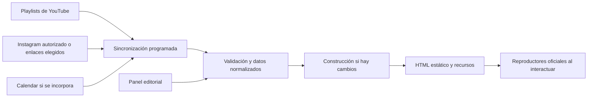

# Automatización de contenidos para la web de Caudal de Vida

Análisis de viabilidad y propuesta de implementación · 17 de octubre de 2026.

La prioridad confirmada es reutilizar [Instagram de Caudal](https://www.instagram.com/caudaldevida/) y [YouTube de Caudal](https://www.youtube.com/@CaudaldeVida). Recomiendo lanzar con mensajes y series alimentados desde playlists de YouTube, más una selección de reels de Instagram. Google Calendar y otras herramientas quedan como ampliaciones sujetas a confirmar su uso en la iglesia.

La web puede seguir entregando HTML estático. Un proceso programado consulta las fuentes, actualiza una copia de los datos necesarios y publica cuando encuentra cambios. Los reproductores oficiales se cargan al interactuar. El equipo conserva la posibilidad de destacar, excluir y corregir la presentación desde el panel.

## Contenidos que Caudal ya tiene

### Biblioteca de YouTube

La revisión pública del canal y su pestaña de playlists permitió identificar estas colecciones existentes. Sus nombres e identificadores sirven como punto de partida; antes de conectarlas se comprobarán permisos de reproducción y reglas editoriales.

| Colección existente | Enlace | Uso propuesto |
| --- | --- | --- |
| MENSAJES | [Abrir playlist](https://www.youtube.com/playlist?list=PLIbltRa2HNAY7KF8jUyNH19HXvHs7rXpr) | Mensaje destacado y biblioteca principal |
| Día a Día Temporada 2 | [Abrir playlist](https://www.youtube.com/playlist?list=PLIbltRa2HNAZoZDhbLUqf5fku2pKwtHBX) | Serie para acompañar la semana |
| Día a Día Temporada 1 | [Abrir playlist](https://www.youtube.com/playlist?list=PLIbltRa2HNAYiZKJ5V4Kwq06ZF3RlHrV5) | Archivo de la serie |
| MÚSICA | [Abrir playlist](https://www.youtube.com/playlist?list=PLIbltRa2HNAaF7hf6d8KQyFWekqSGzXFR) | Sección opcional de adoración |
| Intensivos y encuentros anteriores | [Ver playlists del canal](https://www.youtube.com/@CaudaldeVida/playlists) | Recursos históricos, separados de la agenda futura |

También aparecen mensajes individuales como «Cuando llega Jesús» y «Espera, ¡No te Rindas!». Hay material suficiente para organizar recorridos editoriales desde contenidos existentes. No hace falta comenzar una biblioteca vacía ni volver a subir los videos.

### Instagram y estética en uso

Se observó la grilla pública visible de [@caudaldevida](https://www.instagram.com/caudaldevida/), tras cerrar el aviso opcional de registro. La [captura de referencia](muestra-instagram/instagram-caudal.png) conserva esa muestra. La lectura se limita a las piezas visibles, sin atribuirles una frecuencia de publicación ni un rendimiento que no se midió.

- El monograma de Caudal funciona en blanco y negro; la biografía expresa «Vida para la Ciudad».
- Los destacados utilizan fondos claros e iconos azules para horarios, grupos y ministerios.
- La grilla combina fotografías y fragmentos de predicación con placas de campaña.
- Se observan títulos serif altos, tipografías inclinadas o caligráficas de acento y texto sans serif para información práctica.
- Conviven crema con bordó y detalles florales, campañas en marrón cálido y otras piezas azules de mayor contraste.
- Los reels de predicación muestran personas, escenarios y subtítulos superpuestos.

En las miniaturas de YouTube observadas se repiten retratos y títulos expresivos: fondos oscuros y texto claro en mensajes, azules en otras piezas y una presentación más luminosa en Día a Día. [Canal de origen](https://www.youtube.com/@CaudaldeVida).

**Ajuste recomendado a la propuesta estética:** una base editorial cálida, con monograma monocromo, crema, tinta oscura y azul como acento a evaluar. Mantener la expresividad de las campañas dentro de sus tarjetas. El verde profundo de la propuesta inicial sigue siendo una exploración; no se identificó como color dominante en esta muestra y no debe tratarse como color oficial.

Las fuentes exactas y valores de color necesitan originales o manual de marca. La interfaz debe acompañar estas piezas variadas: tarjetas consistentes, imágenes completas cuando contienen texto y navegación fácil de leer. Los reels verticales pueden tener una sección propia llamada **La vida en Caudal**, con tres piezas en escritorio y desplazamiento horizontal accesible en móvil.

La muestra del perfil y la web actual no coinciden plenamente en el horario dominical de la tarde. Confirmarlo y mantener un dato institucional central antes de publicar; importar contenido social no debe sobrescribir automáticamente los horarios permanentes. [Web actual](https://caudaldevida.net/) e [Instagram](https://www.instagram.com/caudaldevida/).

## Qué automatizar primero

| Integración | Qué hace el equipo | Qué recibe la web | Prioridad |
| --- | --- | --- | --- |
| Playlist MENSAJES | Publica y organiza videos en YouTube | Mensajes recientes, miniaturas y reproductor | Lanzamiento |
| Playlists Día a Día | Mantiene las colecciones en YouTube | Series y episodios disponibles | Lanzamiento |
| Reels seleccionados | Elige enlaces y una fecha de vigencia cuando corresponda | Sección visual con contenido ya producido | Lanzamiento |
| Importación de Instagram | Autoriza la cuenta profesional y revisa candidatos | Nuevas piezas disponibles para selección | Segunda etapa, según acceso |
| Agenda en Calendar | Actualiza un calendario destinado a la web | Próximos eventos y cambios de horario | Segunda etapa, si ya lo utilizan |

Publicar automáticamente desde una fuente editorial elegida permite reducir trabajo sin convertir cada publicación social en un destacado de portada. Los saludos, convocatorias vencidas y mensajes permanentes tienen usos diferentes.

## YouTube y playlists

### Opción inmediata con reproductor de playlist

YouTube permite incrustar una playlist mediante su reproductor oficial. La lista que ve el visitante refleja el contenido y orden de YouTube sin que haya que editar el HTML por cada incorporación. No requiere configurar la Data API para reproducir esa lista pública. [Documentación del reproductor](https://developers.google.com/youtube/player_parameters).

La playlist MENSAJES identificada podría utilizarse directamente:

`https://www.youtube.com/embed?listType=playlist&list=PLIbltRa2HNAY7KF8jUyNH19HXvHs7rXpr`

Es una solución sencilla para una sección de videos. El primer elemento depende del orden de la playlist: no garantiza por sí solo mostrar el mensaje más reciente. Tampoco genera fichas estáticas individuales con títulos y descripciones para la biblioteca de la web.

### Opción recomendada con biblioteca propia

Consultar `playlistItems.list` para obtener los identificadores de una colección y `videos.list` para completar metadatos y disponibilidad. Ambos métodos tienen un costo de cuota documentado de una unidad por solicitud; las paginaciones y consultas adicionales también consumen cuota. [PlaylistItems](https://developers.google.com/youtube/data/reference/rest/v3/playlistItems/list) y [Videos](https://developers.google.com/youtube/data/reference/rest/v3/videos/list).

Flujo propuesto:

1. Configurar las playlists aprobadas y una clave de API restringida para lecturas públicas. OAuth solo si se necesitan recursos que requieran autorización del propietario.
2. Consultar novedades cada treinta a sesenta minutos como punto de partida.
3. Guardar identificador, título, descripción, fecha de publicación, miniatura, duración y pertenencia a series cuando estén disponibles.
4. Generar fichas y páginas de mensajes; mostrar un reproductor oficial al pulsar Ver.
5. Evitar duplicados por `videoId`, aunque un video aparezca en más de una colección.
6. Retirar o marcar los videos eliminados, privados o que ya no puedan reproducirse en la web. Ofrecer enlace a YouTube cuando corresponda.

La fecha de publicación de un video, la fecha en que se agregó a una playlist y la fecha de la predicación son datos distintos. Si se necesita esta última, el equipo podrá agregarla como dato editorial.

**Regla para portada:** elegir el video público elegible más reciente de MENSAJES, con opción de fijar manualmente otro. Excluir emisiones futuras, pruebas y contenido que no corresponda. Si la playlist mezcla formatos, crear una playlist específica para la web o definir exclusiones; no clasificar Shorts solo por duración.

La API expone información de estado e inserción, pero la reproducción final también puede depender de restricciones del video o del visitante. Probar piezas reales, conservar atribución y reproductor de YouTube, y no prometer quitar su marca o todos los videos relacionados. [Recurso de video](https://developers.google.com/youtube/data/reference/rest/v3/videos) y [parámetros](https://developers.google.com/youtube/player_parameters).

Para una biblioteca grande, importar inicialmente una selección y paginar el archivo. La caché debe renovarse y respetar retiros y reglas de almacenamiento: no es una copia permanente independiente de YouTube. [Políticas de la API](https://developers.google.com/youtube/terms/developer-policies).

### En vivo

En la primera versión, permitir elegir el enlace de la transmisión y su vigencia. Una programación horaria puede anunciar la próxima reunión, pero no demuestra que se esté transmitiendo.

Después puede comprobarse el estado de un video conocido mediante la API y cambiar entre Próximamente, En vivo y Último mensaje. Evitar búsquedas generales continuas para descubrir transmisiones. Las notificaciones de YouTube sirven para determinadas novedades del canal; un cambio en el orden de una playlist requiere otra comprobación. [Notificaciones del canal](https://developers.google.com/youtube/data/guides/push_notifications).

## Instagram y reels

### Incrustar una publicación conocida

La opción más simple es guardar el enlace de un reel o publicación pública y mostrar su inserción oficial cuando esté disponible y el propietario permita incrustarla. El editor elige el contenido; el sistema construye su presentación sin subir de nuevo el video.

Hay un cambio relevante para este proyecto: Meta anunció el **15 de junio de 2026** el acceso a oEmbed de contenido público sin token ni revisión de aplicación para esa funcionalidad. Esto simplifica convertir un enlace conocido en un bloque incrustado; **no convierte oEmbed en una API para listar todas las publicaciones de una cuenta**. [Anuncio oficial de Meta](https://developers.facebook.com/blog/post/2026/06/15/tokenless-access-to-meta-oembed-apis/).

Para Caudal, comenzar con tres reels elegidos y una pequeña biblioteca de candidatos. Guardar enlace, título editorial breve, categoría, fecha de selección, vigencia y estado. Si se necesita una portada propia, utilizar un archivo autorizado del equipo creativo: no depender de que oEmbed devuelva miniaturas o metadatos completos.

Ante un reel eliminado, privado, restringido o con inserción deshabilitada, mostrar una alternativa o retirar la tarjeta. Mantener el enlace al perfil. Los scripts externos se cargan al solicitar el contenido; no cargar seis reproductores al abrir la portada.

### Detectar automáticamente nuevas publicaciones

Para importar el contenido propio se evalúa Instagram API con autorización de una cuenta profesional Business o Creator. Instagram Login permite esa conexión sin exigir una página de Facebook vinculada; la modalidad con Facebook Login tiene requisitos diferentes. La colección oficial de Meta documenta estas vías. [Instagram Login](https://www.postman.com/meta/instagram/folder/6raa77c/instagram-api-with-instagram-login) y [API de Meta](https://www.postman.com/meta/instagram/documentation/6yqw8pt/instagram-api).

El tipo de cuenta de @caudaldevida y sus permisos deben verificarse con quien la administra: no se deducen del número de seguidores o de la apariencia del perfil. Configurar una aplicación, acceso de lectura adecuado, gestión de tokens y los requisitos de acceso que correspondan a la cuenta y al uso real.

Flujo propuesto: consulta periódica → normalización de publicaciones → bandeja de candidatos → selección o regla editorial → sección de reels. Consultar de dos a cuatro veces al día alcanza como punto de partida para esta sección; no se plantea como actualización instantánea.

Para la primera etapa recomiendo **importar candidatos y elegir qué mostrar**. Más adelante puede automatizarse la publicación de categorías acordadas. Toda pieza con una convocatoria necesita fecha de vencimiento; no inferir una fecha fiable únicamente leyendo el texto de un flyer.

### Alternativas y mantenimiento

| Modalidad | Ventaja | Límite |
| --- | --- | --- |
| Enlaces seleccionados e inserción oficial | Menor complejidad y control de portada | Requiere elegir las piezas; no descubre novedades |
| API de la cuenta profesional | Permite detectar contenido propio y clasificarlo | Acceso, tokens y mantenimiento de integración |
| Widget de un proveedor | Puede simplificar la puesta en marcha | Servicio adicional, condiciones, costo y dependencia del proveedor |
| Archivos originales del equipo | Permiten una composición web propia | Requieren entrega, almacenamiento y derechos adecuados para ese uso |

La inserción oficial no equivale a descargar y volver a alojar los videos. No basar la web en extraer el feed mediante scraping ni en URLs temporales de medios. Si se desea alojar un clip propio, trabajar desde el original y verificar también el uso de su música. Las licencias de la biblioteca musical de Instagram no se deben presuponer extensibles a otro alojamiento. [Información de Meta sobre música](https://www.facebook.com/help/instagram/402084904469945).

## Google Calendar como agenda futura

Viable, pero su uso por la iglesia no está confirmado. Recomiendo un calendario separado llamado **Agenda pública Caudal**. Puede ser público para consulta directa o compartirse de forma privada con la integración; en ambos casos solo debe contener información destinada a publicarse. Las reuniones internas siguen en otros calendarios.

Hay tres alternativas:

- **Calendario incrustado:** implementación rápida y presentación de Google, con personalización limitada. Para verlo sin permisos individuales debe ser público. [Ayuda de Google](https://support.google.com/calendar/answer/41207).
- **API y tarjetas propias:** opción recomendada para una agenda visual coherente con Caudal. Importar título, inicio, fin, lugar, descripción y enlace mediante `events.list`. Usar acceso de lectura según visibilidad; una clave no concede acceso a un calendario privado. [Calendar API](https://developers.google.com/workspace/calendar/api/v3/reference/events/list).
- **Suscripción iCalendar:** útil para que las personas sigan la agenda o como vía de lectura si existe un feed público. Un enlace iCal privado funciona como credencial y no se publica. Para tarjetas propias también necesita un proceso de importación.

Calendar será dueño de fechas, horarios, lugar y cancelaciones. El CMS agregará fotografía, categoría, enlace de inscripción y prioridad de portada, vinculados al identificador externo. Así un cambio de horario no se corrige a mano en dos sistemas.

Considerar recurrencias y sus excepciones, cancelaciones, eventos de día completo y zona `America/Argentina/Buenos_Aires`. La API permite expandir recurrencias con `singleEvents`; una ocurrencia cancelada no debe reaparecer al reconstruir la serie. [Referencia de eventos](https://developers.google.com/workspace/calendar/api/v3/reference/events).

Para comenzar, volver a consultar una ventana acotada de los próximos noventa días cada quince a treinta minutos, con paginación. Las notificaciones push y la sincronización incremental son evoluciones posibles: requieren un receptor, consultas posteriores y renovación de canales; no son una agenda actualizada sin backend. [Push](https://developers.google.com/workspace/calendar/api/guides/push) y [sincronización](https://developers.google.com/workspace/calendar/api/guides/sync).

## Otras automatizaciones que aprovechan trabajo existente

Estas propuestas se activan solo si el equipo ya usa la herramienta correspondiente y aporta una fuente adecuada.

| Fuente | Automatización propuesta | Valor y condición |
| --- | --- | --- |
| Google Sheets | Directorio de grupos, disponibilidad o necesidades de Misiones | Importar solo columnas públicas; puede alimentar filtros sin exponer la planilla entera |
| Google Drive | Recepción de originales para campañas o galería aprobada | Carpeta editorial seleccionada; importar y optimizar antes de servir medios desde la web |
| Google Forms o plataforma de eventos | Mantener formularios e inscripciones existentes | La tarjeta web dirige al formulario correcto; los cupos solo se sincronizan si existe acceso fiable a esos datos |
| Herramienta de diseño existente | Plantillas de portada, eventos y mensajes | Estandarizar exportaciones; conectar una API solo si aporta valor y el servicio la admite |
| Podcast existente | Episodios desde un feed RSS oficial | Permite aprovechar audio publicado, si existe ese canal |
| Contenido aprobado | Paquete semanal de enlaces y novedades como borrador | Facilita comunicación; el responsable decide dónde y cuándo enviarlo |
| Transcripción o archivo de un mensaje | Borrador de resumen, temas y preguntas para grupos | Revisión editorial y pastoral antes de publicar; no asumir acceso automático a subtítulos de cualquier video |

Las APIs de [Sheets](https://developers.google.com/workspace/sheets/api/reference/rest/v4/spreadsheets.values/get) y [Drive](https://developers.google.com/workspace/drive/api/reference/rest/v3/files/list) permiten leer datos autorizados, pero no convierten una carpeta o planilla interna en contenido automáticamente apto para publicar.

Para WhatsApp, mantener inicialmente enlaces oficiales a canal y contacto. No se asume una API pública de lectura de canales ni se propone copiar conversaciones. La distribución automática de mensajes a personas es un alcance distinto de alimentar la web y necesitaría definir su circuito y autorización.

## Arquitectura y fuentes de verdad

El proceso puede ejecutarse con un script y un programador del hosting. Si la iglesia ya utiliza una herramienta de automatización, evaluar su reutilización; no sumar otro servicio por defecto.

| Dato | Fuente principal | Edición en el panel |
| --- | --- | --- |
| Video, título y miniatura de origen | YouTube | Texto editorial adicional y prioridad, separados de los datos importados |
| Reel y autoría | Instagram | Selección, categoría, descripción web y vigencia |
| Fecha y cancelación de evento integrado | Calendar | Imagen, acción y promoción |
| Visión, bienvenida y datos institucionales | CMS | Edición directa con revisión |

Guardar `source`, `externalId`, `sourceUpdatedAt`, `lastFetchedAt`, `editorialStatus` y exclusiones. La importación debe actualizar datos sin borrar decisiones editoriales. No sincronizar en ambos sentidos al comienzo. Si se usa el CMS como almacenamiento de importaciones, impedir que sus webhooks generen ciclos de reconstrucción.

Consultar las APIs desde el proceso de integración; mantener tokens fuera del navegador, del HTML y del repositorio. Publicar solo datos necesarios. La frecuencia de consulta y la frecuencia de construcción pueden ser distintas: reconstruir únicamente cuando cambie el resultado público.

### Comportamiento ante fallas

- Si falla la consulta, no interpretar una respuesta fallida como un catálogo vacío.
- Conservar temporalmente la última versión válida y avisar al responsable, con límite de antigüedad por fuente.
- Para metadatos de YouTube importados, renovar o retirar según sus políticas y antes del máximo aplicable; no mantener indefinidamente la caché por una falla prolongada.
- Retirar eventos ya vencidos según sus fechas, aunque la consulta esté fallando; avisar al equipo si no se pueden confirmar cambios recientes.
- Mantener una alternativa permanente para el banner y un enlace al canal o perfil si el reproductor falla.
- Registrar consultas fallidas, credenciales vencidas y última sincronización visible para administración.

## Implementación y pruebas de viabilidad

1. **YouTube:** confirmar las playlists elegidas, importar una muestra, probar videos reales, orden, fechas y exclusiones. Definir si MENSAJES ya está curada o si conviene una lista específica para la web.
2. **Instagram:** probar una publicación y dos reels reales con inserción oficial. Comparar lectura, tiempos y comportamiento móvil. Después verificar la cuenta profesional y el acceso de lectura si se desea descubrimiento automático.
3. **Diseño:** probar en la portada un mensaje destacado, tres reels y acceso a Día a Día, respetando las proporciones y la estética observada.
4. **Operación:** simular eliminación de un video, reel no disponible, API caída y vencimiento de una convocatoria. Comprobar aviso y contenido alternativo.
5. **Calendar:** activar la prueba solo si se confirma la herramienta y un calendario para publicación. Verificar una recurrencia con excepción y un evento cancelado.

El resultado esperado del lanzamiento es que comunicación siga publicando en sus canales habituales y solo tenga que seleccionar destacados o completar contexto específico de la web. La frecuencia propuesta es un objetivo de operación, no una promesa de actualización instantánea.

## Decisiones concretas antes de conectar

- Responsable y tipo de cuenta de Instagram; autorización de lectura si corresponde.
- Playlists de YouTube aprobadas y regla para elegir el mensaje de portada.
- Tres reels iniciales, categorías y política de vencimiento.
- Permiso para aprovechar originales y plantillas existentes.
- Frecuencia tolerable de actualización, responsable ante fallas y presupuesto de mantenimiento.
- Uso real de Calendar y otras herramientas, reservado para la etapa siguiente.

Esta etapa entrega el análisis y la especificación. No se conectaron cuentas, no se generaron credenciales y no se modificaron publicaciones de los canales.
